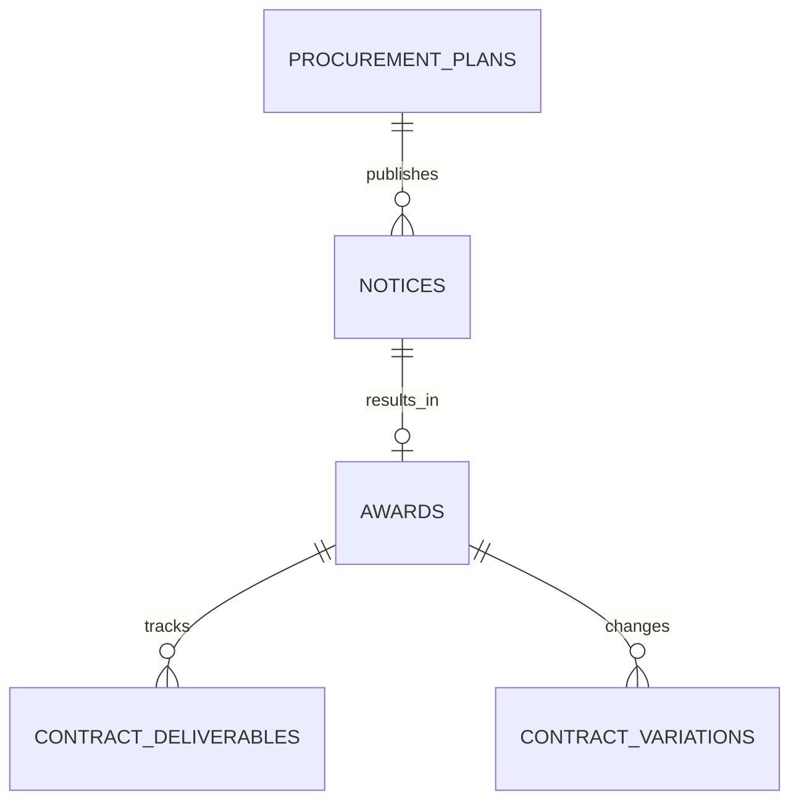

# Uganda Procurement Award and Contract-Delivery Monitor

**Status:** synthetic educational implementation; PostgreSQL execution unverified.  
**Engine:** PostgreSQL 15+. **Purpose:** monitor planning notices, disclosed awards, contract deliverables and variation review.

## Intended users and data ownership

Procurement planning officers, authorised contract clerks, independent variation reviewers and public disclosure reviewers. A real implementation requires the procuring entity to identify the authoritative procurement record, records custodian, applicable procurement rules and the lawful disclosure fields. The package does not contain real bid submissions, confidential evaluation records, bank details or real supplier identities.

## Model

## Setup

Run files in numeric order on a disposable PostgreSQL 15+ database. The versioned migration uses psql `\\ir` includes. All fixtures are synthetic and use UGX amounts.

## Safeguards

- Public reporting is exposed only through a disclosure-reviewed view.
- Variation approval requires reviewer identity and evidence, and prevents non-positive revised contract values.
- Procurement award and variation decisions require an accountable human; the SQL does not select a supplier or determine legal compliance.
- Restricted bids and protected documents must stay in a separately secured repository.
- Configure retention, access logging, segregation of duties, and records correction before use.
- Check procurement thresholds, methods, approvals and publication rules with qualified local owners.

## Validation

The package includes a seed, views, workflow routine, role grants, indexes and transactional assertions. SQL tests have **not** been executed in this session. Do not use live procurement data until a disposable database run, security review, concurrency review, recovery exercise and data-owner acceptance pass.
