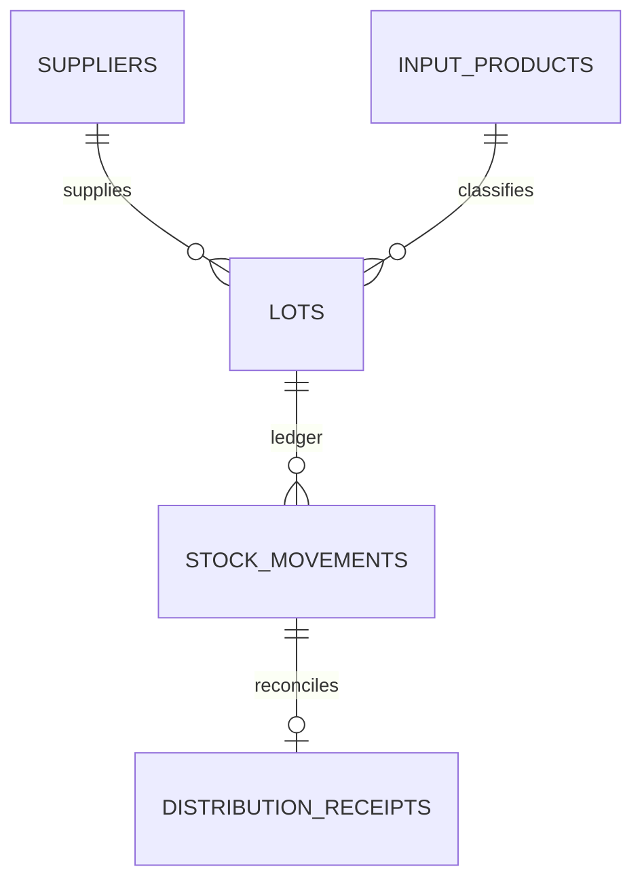

# Uganda Agricultural Input Distribution Audit

**Status:** synthetic educational implementation; SQL execution not yet verified.  
**Engine:** PostgreSQL 15+. **Scope:** supplier lots, warehouse stock movements, recipient dispatches and receipt reconciliation.

## Purpose and boundaries

This package demonstrates traceability for seeds, fertiliser, tools and similar agricultural inputs from receipt through issue and recipient confirmation. It is not an official NAADS, NARO, ministry or district distribution system. It does not assert eligibility, programme coverage or impact.

Recipient references are opaque tokens. Do not store beneficiary names, national IDs, phone numbers, household addresses or other personal details in this schema.

## Model



The stock-movement function locks the lot row, computes balance from the ledger and prevents outbound movement from underflowing stock. Every movement has a unique idempotency key, source document, reason and actor. Receipts are separate from dispatch records so quantity discrepancies remain visible.

## Setup

Run on a disposable PostgreSQL 15+ database using a controlled schema owner.

```bash
psql "$DATABASE_URL" -v ON_ERROR_STOP=1 -f 01_schema.sql
psql "$DATABASE_URL" -v ON_ERROR_STOP=1 -f 02_seed.sql
psql "$DATABASE_URL" -v ON_ERROR_STOP=1 -f 03_views.sql
psql "$DATABASE_URL" -v ON_ERROR_STOP=1 -f 04_procedures.sql
psql "$DATABASE_URL" -v ON_ERROR_STOP=1 -f 06_security.sql
psql "$DATABASE_URL" -v ON_ERROR_STOP=1 -f 08_tests.sql
```

The versioned migration uses psql `\\ir` includes. All fixtures are synthetic.

## Safeguards

- Require goods-received notes, batch/lot identifiers and authorised supplier records.
- Use calibrated measurement and auditable quantity/quality adjustments.
- Separate warehouse custody, dispatch approval, receipt confirmation and reconciliation.
- Preserve write-off reasons and approvals; never silently alter ledger history.
- Validate product safety, registration, storage and expiry requirements with qualified authorities.
- Treat anomalies as review prompts, not evidence of diversion or misconduct.
- Define beneficiary dispute, correction, privacy and record-retention processes before live use.

## Validation status

`08_tests.sql` asserts underflow protection, idempotency and recipient requirements. These assertions have **not** been executed in a PostgreSQL runtime in this session. Real programme rules, product-specific handling and financial reconciliation need independent review.
