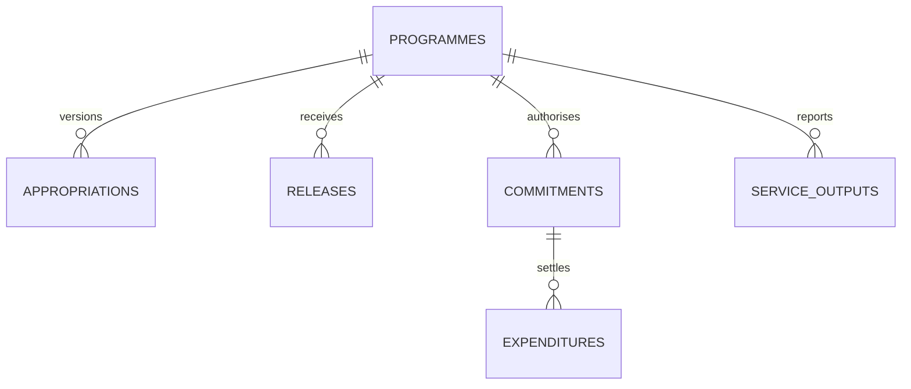

# Uganda Budget Execution and Service-Output Dashboard

**Status:** synthetic monitoring example; PostgreSQL execution unverified.  
**Scope:** appropriation versions, releases, commitments, expenditure references and service outputs.

## Intended users and ownership

Budget planners, finance clerks, programme managers and oversight reviewers. The deploying institution must define the authoritative budget source, fiscal-period rules, release reconciliation, commitment approval authority and verified output definitions. This is not a general ledger, treasury integration or official financial statement.

## Model

## Setup

Run numbered SQL files in order on a disposable PostgreSQL 15+ database. The versioned migration uses psql `\\ir` includes. Synthetic money values use UGX.

## Definitions and controls

- Current appropriation is the highest recorded approved version; preserve prior versions.
- Releases, active commitments and expenditures are summed separately to avoid join multiplication.
- Expenditure recording locks the commitment and refuses totals above the approved commitment amount.
- A unique idempotency key and unique payment reference prevent repeat recording under the same token/source.
- Output achievement is meaningful only with documented metric definition, period, unit, provenance and quality review.
- A negative variance is an exception to investigate, not evidence of misconduct.
- Apply maker-checker controls, office scope, access logging, close-period controls and backup/recovery procedures before operational use.

## Validation

Included assertions cover commitment overrun and idempotency. SQL was **not executed in this session**. Validate budget revisions, cancelled commitments, period close, payment reversals, concurrency and accounting reconciliation with qualified finance owners before live use.
