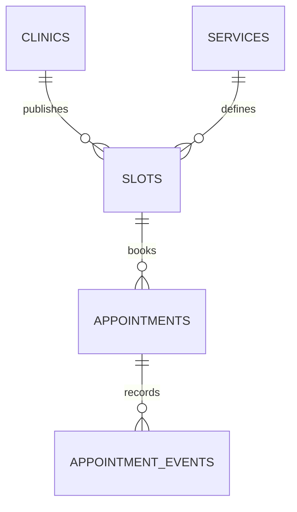

# Uganda Clinic Appointment and Queue Planner

**Status:** synthetic educational implementation; SQL execution not yet verified.  
**Engine:** PostgreSQL 15+. **Scope:** service slots, appointments, cancellation and aggregate clinic load.

## Purpose and boundaries

This package demonstrates conflict-safe scheduling and appointment queue reporting. It is not a clinical record system, patient registry or integration with any health facility system. It does not store diagnoses, prescriptions, names, national IDs or patient contact details.

## Model



Slot booking locks the selected slot row and uses a partial unique index to prevent two active appointments for one slot. Cancellation records a reason and releases the slot for reuse. The appointment patient reference is opaque and synthetic.

## Setup

Run on a disposable PostgreSQL 15+ database using a controlled schema owner.

```bash
psql "$DATABASE_URL" -v ON_ERROR_STOP=1 -f 01_schema.sql
psql "$DATABASE_URL" -v ON_ERROR_STOP=1 -f 02_seed.sql
psql "$DATABASE_URL" -v ON_ERROR_STOP=1 -f 03_views.sql
psql "$DATABASE_URL" -v ON_ERROR_STOP=1 -f 04_procedures.sql
psql "$DATABASE_URL" -v ON_ERROR_STOP=1 -f 06_security.sql
psql "$DATABASE_URL" -v ON_ERROR_STOP=1 -f 08_tests.sql
```

The versioned migration uses psql `\\ir` includes. All data is synthetic.

## Safeguards

- Use opaque patient references only; do not store clinical details in this package.
- Apply facility-specific scheduling rules, staffing capacity, service durations and booking windows.
- Keep the slot lock and partial unique index; also test contention with concurrent database sessions.
- Define cancellation, no-show, rescheduling, accessibility and urgent-care override procedures with clinicians.
- Aggregate reporting should avoid exposing individual attendance patterns.
- Plan for intermittent connectivity and an authorised manual scheduling fallback.
- Use least-privilege identities and restrict staff-level appointment views.

## Validation status

`08_tests.sql` asserts one-active-booking-per-slot, cancellation release and required cancellation reasons. These assertions have **not** been executed in a PostgreSQL runtime in this session. Production use requires concurrency, privacy, recovery and workflow review.
