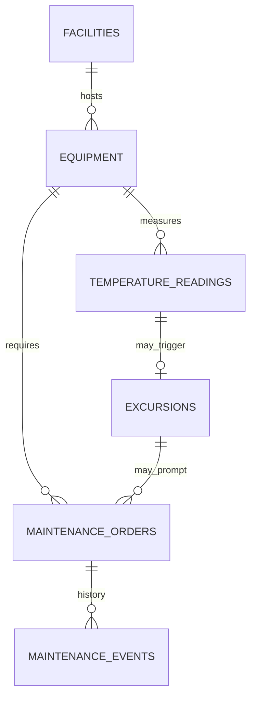

# Uganda Cold-Chain Monitoring and Equipment Maintenance

**Status:** synthetic educational implementation; SQL execution not yet verified.  
**Engine:** PostgreSQL 15+. **Scope:** cold-chain equipment metadata, temperature observations, excursions and maintenance work orders.

## Purpose and boundaries

This package demonstrates temperature monitoring and equipment-maintenance workflows for a generic health-facility setting. It is not an official vaccine registry, inventory system, clinical decision system or connection to any Ugandan health authority. No patient, vaccine-batch or live facility records are included.

## Model



The reading function records source provenance, captures whether calibration was current at observation time, and creates an excursion when a temperature is outside configured limits. If calibration is overdue, active equipment is moved to a quarantined status for review. The work-order function enforces transitions and requires completion evidence. These controls generate alerts and review queues; they do not decide whether any biological product remains safe.

## Setup

Run on a disposable PostgreSQL 15+ database using a controlled schema owner.

```bash
psql "$DATABASE_URL" -v ON_ERROR_STOP=1 -f 01_schema.sql
psql "$DATABASE_URL" -v ON_ERROR_STOP=1 -f 02_seed.sql
psql "$DATABASE_URL" -v ON_ERROR_STOP=1 -f 03_views.sql
psql "$DATABASE_URL" -v ON_ERROR_STOP=1 -f 04_procedures.sql
psql "$DATABASE_URL" -v ON_ERROR_STOP=1 -f 06_security.sql
psql "$DATABASE_URL" -v ON_ERROR_STOP=1 -f 08_tests.sql
```

The versioned migration uses psql `\\ir` includes. All fixtures are synthetic.

## Operational safeguards

- Validate approved temperature ranges, calibration schedules and alert escalation with qualified cold-chain personnel.
- Preserve readings and source evidence; do not overwrite historical observations to hide excursions.
- Treat a temperature excursion as an investigation trigger, not an automatic product-disposition decision.
- Record calibration state and use calibrated sensors; separate sensor data from product inventory and batch disposition.
- Limit access to facility and equipment details, particularly for critical infrastructure.
- Define response SLAs, escalation contacts, maintenance vendors and offline/manual fallback.
- Test backup restoration and sensor-import idempotency before operational use.

## Validation status

`08_tests.sql` asserts excursion creation, evidence-gated completion, valid workflow sequencing and idempotency. These assertions have **not** been executed in a PostgreSQL runtime in this session. Real temperature limits, severity bands and escalation policies require authoritative technical review.
