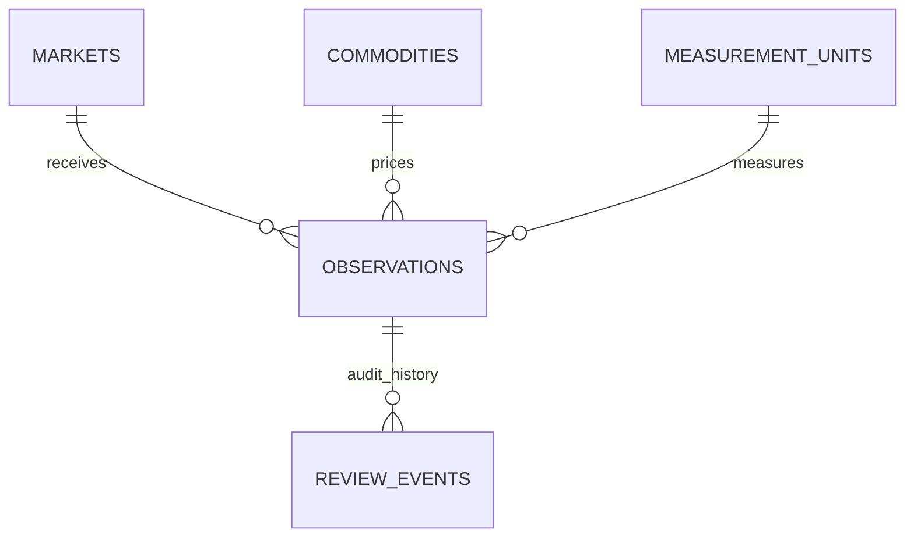

# Uganda Market-Price Collection and Validation

**Status:** synthetic educational implementation; SQL execution not yet verified.  
**Engine:** PostgreSQL 15+. **Purpose:** collect sourced market-price observations and route them through human review.

## Scope

This package demonstrates commodity price observations by market, date, declared unit and currency; provenance and idempotency; a reviewer queue; accepted-price summaries; and candidate outlier reporting. It does not provide official Ugandan prices, a national statistical release, a ministry portal, or a commodity exchange.

## Model



Each observation stores an opaque collector reference, collection method, source-record reference, timestamp/date, unit, currency and idempotency key. Review decisions require an authenticated reviewer reference, reason and evidence reference. The outlier view only identifies candidates for investigation; it does not make a decision.

## Setup

Run on a disposable PostgreSQL 15+ database with a controlled schema owner.

```bash
psql "$DATABASE_URL" -v ON_ERROR_STOP=1 -f 01_schema.sql
psql "$DATABASE_URL" -v ON_ERROR_STOP=1 -f 02_seed.sql
psql "$DATABASE_URL" -v ON_ERROR_STOP=1 -f 03_views.sql
psql "$DATABASE_URL" -v ON_ERROR_STOP=1 -f 04_procedures.sql
psql "$DATABASE_URL" -v ON_ERROR_STOP=1 -f 06_security.sql
psql "$DATABASE_URL" -v ON_ERROR_STOP=1 -f 08_tests.sql
```

The versioned migration uses psql `\\ir` includes. All included records are synthetic.

## Data quality and governance

- Never compare different units or currencies without a documented conversion process.
- Record source type, publication/source reference, observation date and collector provenance.
- Define market sampling methods, collection frequency, commodity grade and unit conventions before gathering real data.
- Review outliers with human context; price changes can be seasonal or caused by genuine shortages.
- Preserve rejected observations and reasons for audit; correct errors through a linked replacement rather than silently overwriting a value.
- Use approved source permissions/licences and document limitations and sample size.
- Avoid collecting unnecessary personal information about traders or farmers.
- Publish aggregates only with definitions, date ranges, unit, source and quality status.

## Validation status

`08_tests.sql` asserts negative-price rejection, decision evidence requirements, reviewer identity and idempotency. These tests have **not** been executed in a PostgreSQL runtime in this session. Outlier thresholds are illustrative and must be validated before operational use.
