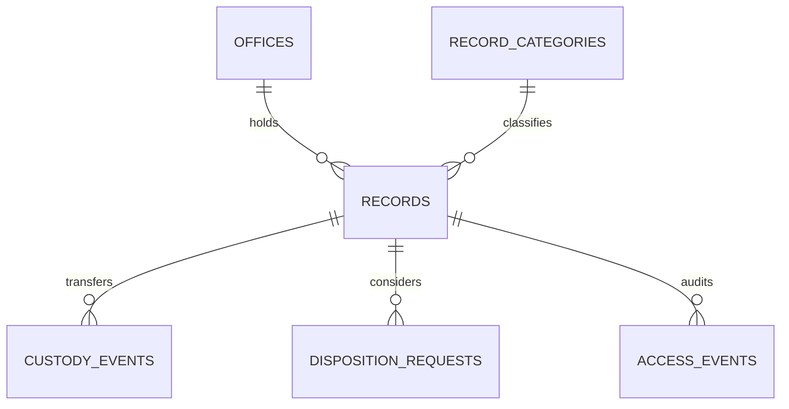

# Uganda Official Records and Correspondence Index

**Status:** synthetic metadata-only implementation; SQL execution unverified.  
**Engine:** PostgreSQL 15+. **Critical boundary:** the index never stores document contents.

## Purpose and roles

A records custodian needs a searchable register of reference numbers, originating office, classification, current custody, retention date, legal hold and disposition evidence. Intended roles are metadata readers, records clerks and independent disposition reviewers. A real office must approve its retention schedule and identify its authoritative record systems.

## Data model

## Install

Apply the numbered SQL files in order on a disposable PostgreSQL 15+ database. The migration uses psql `\\ir` includes. All example references are synthetic; document content stays in separately secured object storage.

## Safeguards

- Classification and access policy must be enforced by both this metadata database and the document store.
- Never dispose of a record under legal hold; retention review is not an automatic destruction instruction.
- Disposition requires a request, evidence-backed independent approval, elapsed retention and separate execution evidence.
- Custody transfers require sender, recipient, evidence and reason.
- Apply encryption, audit review, legal holds, retention exceptions, backup restoration and authorised correction policies.
- Review applicable Ugandan public records, archival and data-protection obligations with qualified records/legal officers.

## Validation

Included assertions exercise custody tracking and reject disposition before retention expiry. They have **not** been run against PostgreSQL in this session. This example is not an official government records system and is not approved for live documents.
