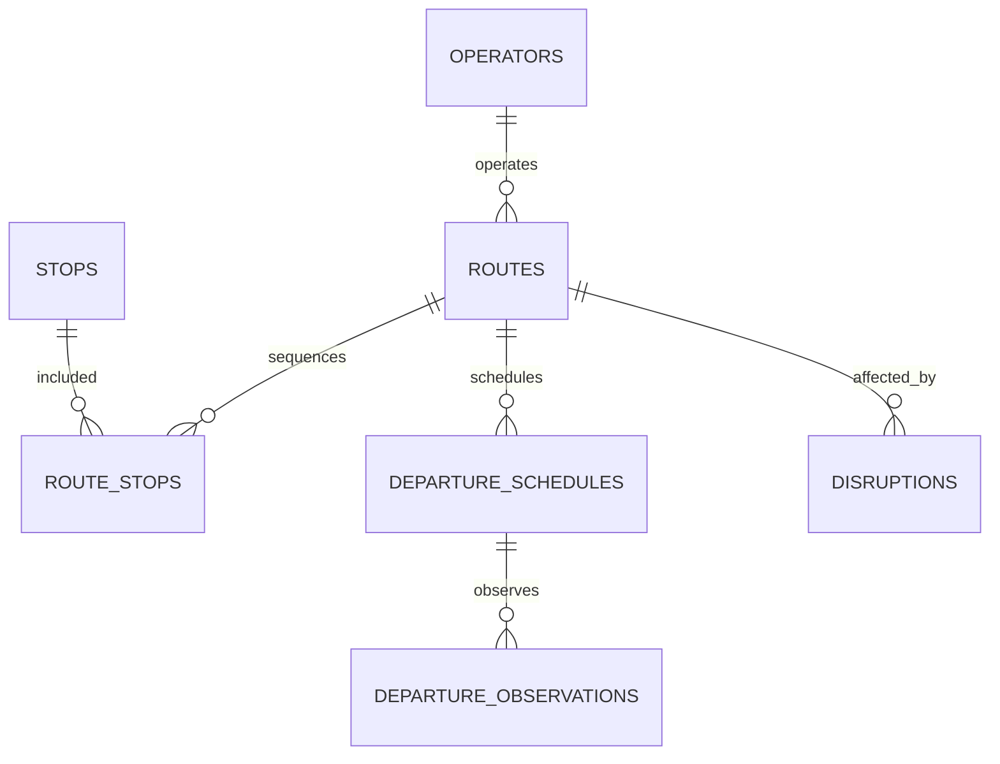

# Uganda Public Transport Reliability Dashboard

**Status:** synthetic route-level analytics example; PostgreSQL execution unverified.  
**Scope:** operators, routes, stops, schedules, departure observations, delays and service disruptions.

## Intended users and data owner

Transport planning units, route operators and service-quality analysts. The data owner must validate the official route definitions, timetable, permitted observation sources and service reliability metrics. The package does not ingest passenger-level movement data or represent official operator performance.

## Model

## Setup

Run numbered files on PostgreSQL 15+. The migration uses psql `\\ir` includes. All route and operator records are synthetic.

## Safeguards

- Missing observations are not counted as cancelled trips or automatically blamed on operators.
- Distinguish scheduled, observed, delayed, cancelled and not-observed states.
- Report route-level service patterns; do not build individual passenger movement profiles.
- Define time zones, holiday/service calendars, accessibility measures and observation-source quality.
- Require review of disruption summaries before publication if they expose safety or critical infrastructure details.

## Validation

Assertions cover missing timestamps and idempotency. PostgreSQL tests have **not** been run in this session. Validate schedule revisions, cancellation handling, time-zone boundaries, duplicate sensor messages and recovery before operational use.
