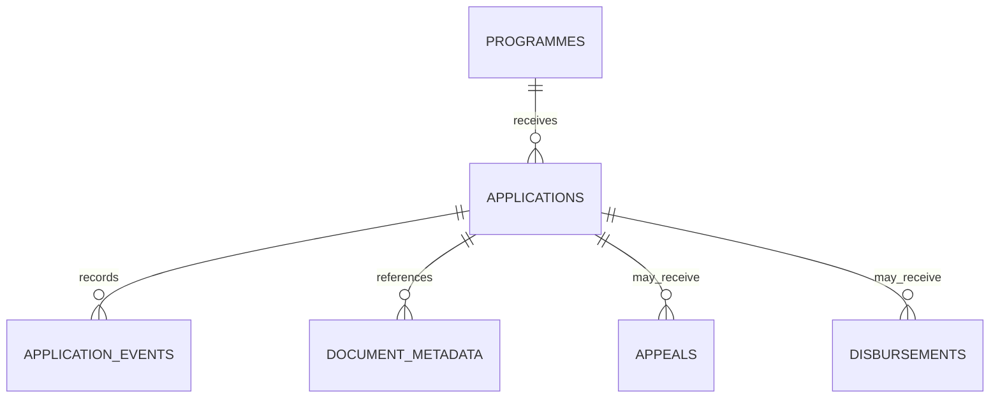

# Uganda Scholarship and Bursary Workflow

**Status:** synthetic educational implementation; SQL execution not yet verified.  
**Engine:** PostgreSQL 15+. **Purpose:** case management for scholarship/bursary applications, appeals and award disbursements.

## Scope and boundaries

This package models a generic, human-reviewed education-support workflow. It is not an official bursary programme, a student information system, an eligibility rules engine or a payment provider integration. Programme rules, application windows, required evidence, award amounts, appeal rights and approval delegations must be confirmed with the actual programme owner before adaptation.

Student and school references are opaque synthetic tokens. Do not store names, national identification numbers, contact details, marks, disability/health details or household financial records in these tables. Document bytes remain in separately controlled storage.

## Model



- Application transitions require an actor and reason; approval/rejection also requires evidence.
- Appeals can be filed only against rejected applications in this demonstrator. An overturned appeal reopens the case for human review rather than auto-approving it.
- Disbursement records require an approved application and cannot exceed the programme award ceiling. Idempotency and external payment references prevent accidental duplicate recording.
- The database does not determine eligibility or rank students automatically.

## Setup

Run on a disposable PostgreSQL 15+ database using a controlled schema owner.

```bash
psql "$DATABASE_URL" -v ON_ERROR_STOP=1 -f 01_schema.sql
psql "$DATABASE_URL" -v ON_ERROR_STOP=1 -f 02_seed.sql
psql "$DATABASE_URL" -v ON_ERROR_STOP=1 -f 03_views.sql
psql "$DATABASE_URL" -v ON_ERROR_STOP=1 -f 04_procedures.sql
psql "$DATABASE_URL" -v ON_ERROR_STOP=1 -f 06_security.sql
psql "$DATABASE_URL" -v ON_ERROR_STOP=1 -f 08_tests.sql
```

The versioned migration uses psql `\\ir` includes. All fixtures are synthetic.

## Safeguards

- Define transparent eligibility and scoring rules with human review and an appeal route.
- Apply separation of duties between application clerks, decision reviewers and finance staff.
- Keep applicant identity and evidence content outside the demo schema, with access logs and retention controls.
- Require source evidence for decisions, appeal outcomes and external disbursement references.
- Reconcile payment records with the authorised finance system; this is not a general ledger.
- Do not publish individual applicant lists or small-cell data that could identify students.
- Review accessibility, non-discrimination, retention, correction and safeguarding with qualified programme owners.

## Validation status

`08_tests.sql` asserts evidence-gated decisions, appeal restrictions and award disbursement limits. These assertions have **not** been executed in a PostgreSQL runtime in this session. Independent privacy, financial-control and programme-policy review is required before operational use.
