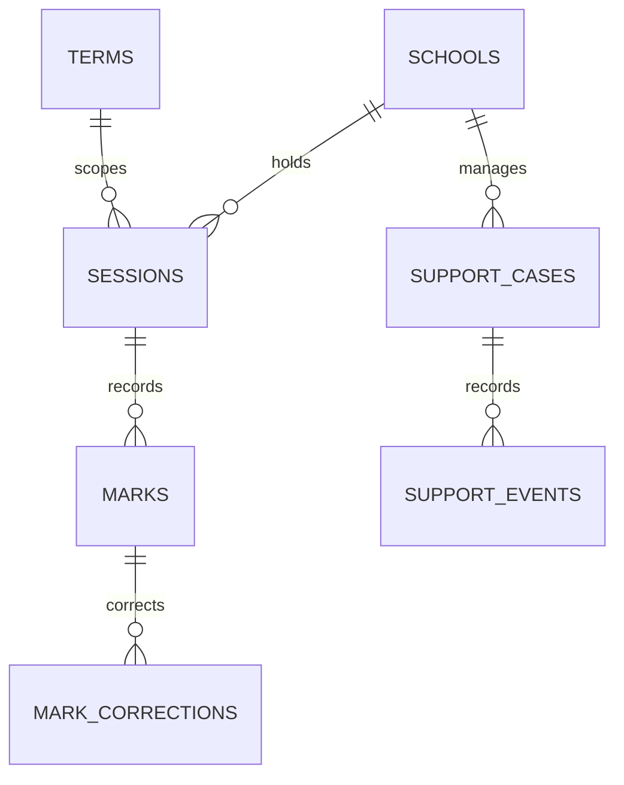

# Uganda School Attendance Support Workflow

**Status:** synthetic learning example; PostgreSQL execution unverified.  
**Scope:** attendance marks, corrections, class/term aggregates and confidential human-led follow-up.

## Intended users and privacy boundary

Authorised school attendance recorders, education oversight readers and trained learner-support staff. This package intentionally uses opaque learner references and stores no names, guardian contacts, national IDs, health records or detailed family circumstances. Any identity mapping must stay in a separately protected, school-authorised system.

## Model

## Setup

Run the numbered SQL files on a disposable PostgreSQL 15+ database. The versioned migration uses psql `\\ir` includes. Fixtures are synthetic.

## Safeguards

- Attendance trends are signals for supportive human inquiry, not proof of neglect, misconduct or learner risk.
- Do not automatically punish, exclude, rank or deny education based on absence counts.
- Case details should be minimal, redacted and access-limited; safeguarding referrals need a separately approved process.
- Use append-only correction evidence rather than silent edits, and record who corrected each mark.
- Suppress small-cell aggregates in external reporting and apply school-level row security in a real deployment.
- Define retention, correction, parent/guardian communication, offline registers and access logs with education and safeguarding professionals.

## Validation

Assertions are included for correction evidence and case reopen flow but **have not been executed** against PostgreSQL here. Operational use requires local policy review, row-scope tests, concurrency checks, restore testing and authorised education-sector acceptance.
