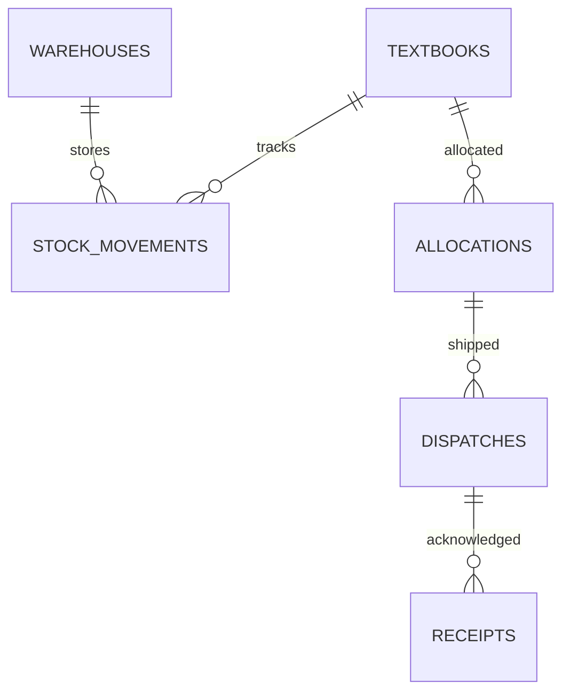

# Uganda School Textbook Distribution Register

**Status:** synthetic education logistics example; PostgreSQL execution unverified.  
**Scope:** textbook catalogue, warehouse stock ledger, school allocations, dispatches, receipts and shortages.

## Intended users and ownership

Education logistics planners, authorised warehouse clerks, receiving-school officers and oversight reviewers. A deploying office must define the authoritative allocation owner, receipt evidence, correction rules and retention schedule. No learner-level information is required or stored.

## Model

## Setup and checks

Run the numbered SQL files on a disposable PostgreSQL 15+ database. The migration uses psql `\\ir` includes. Seeds contain only synthetic school and store tokens. `08_tests.sql` checks stock underflow and duplicate idempotency keys.

## Safeguards

- Use immutable movement rows and correction reasons rather than silently overwriting stock.
- Reconcile dispatched quantity to signed receipt quantity; record shortages and damage with evidence.
- Require dual approval for write-offs and large corrections in a real deployment.
- Scope clerk permissions to assigned stores and school deliveries.
- Do not publish school-level shortage details if it creates unfair targeting; report aggregated counts where appropriate.
- Define offline paper receipt reconciliation for intermittent connectivity and protect paper records.

## Validation status

SQL assertions are included but **were not executed in this session**. Before operational use, validate stock locking under concurrent requests, receipt partials, damaged returns, allocation changes, recovery and authorised education logistics procedures.
