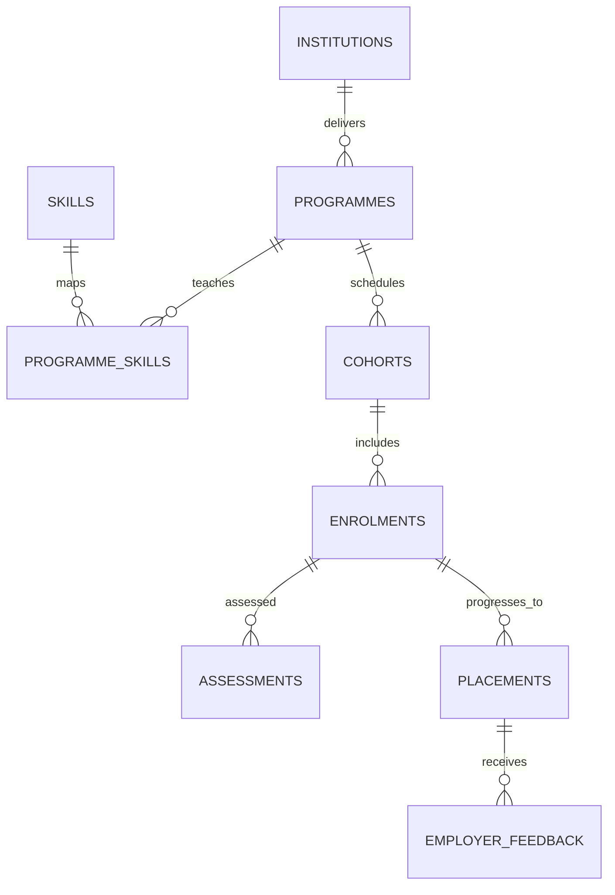

# Uganda TVET and Apprenticeship Outcomes Tracker

**Status:** synthetic educational example; PostgreSQL execution unverified.  
**Scope:** training institutions, programmes, skills, cohorts, enrolments, assessments, placements and employer feedback.

## Intended users and data ownership

TVET programme managers, assessors, placement officers and aggregate oversight analysts. A real deployment needs approved skills-framework references, qualification definitions, trainee consent/notice, placement agreements and retention rules. It is not an accreditation or automated hiring system.

## Model

## Setup

Run numbered files in order on PostgreSQL 15+. The migration uses psql `\\ir` includes. All trainees, employers and evidence are synthetic references.

## Safeguards

- Store opaque trainee tokens only and restrict trainee-level assessment access.
- Do not use this tracker to automatically rank applicants, deny training, or decide employment.
- Treat employer feedback as contextual evidence; define fair assessment and appeal processes.
- Use approved skill frameworks and document version changes.
- Monitor missing outcomes and cohort selection bias; do not publish small-cell trainee results.
- Validate concurrent placement registration and institutional authority before operational use.

## Validation

The included SQL assertions check overlapping placement rejection and cohort completion reporting. They have **not** been executed here. Production use requires qualified TVET owner review, privacy/consent review, row-scope security, concurrency and restore tests.
