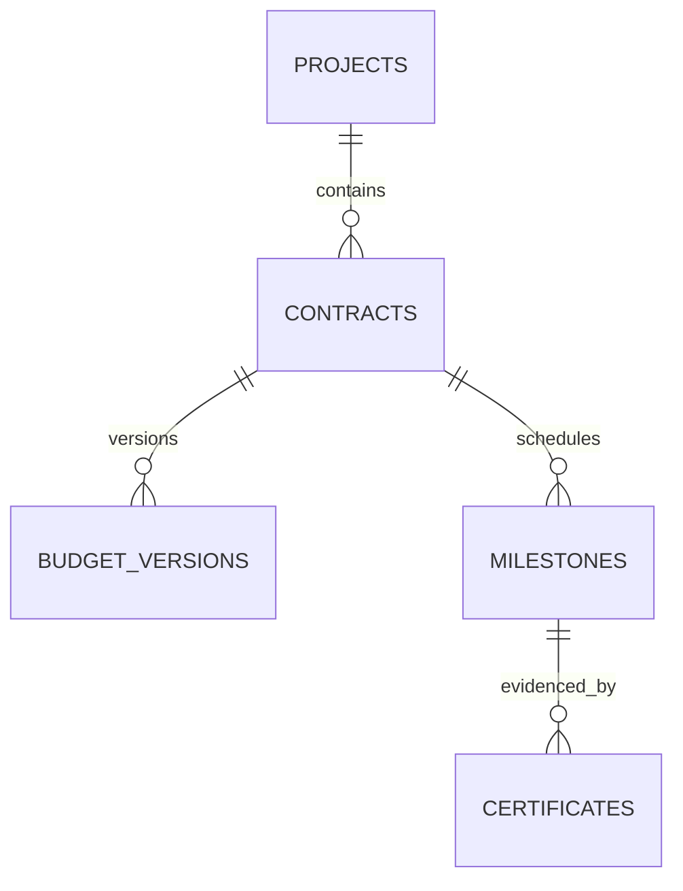

# Uganda Public Works Contract and Milestone Register

**Status:** implemented as a synthetic educational example; PostgreSQL execution is unverified.  
**Engine:** PostgreSQL 15+. **Currency:** UGX by default, with explicit currency codes.

## Problem and users

A public works programme needs to compare contract ceilings, approved budget revisions, scheduled milestones, submitted completion certificates and recorded payments. This model supports project officers, contract clerks, independent technical reviewers and finance officers. It is not an official government procurement or payment system.

## Data ownership and boundaries

A real deploying office must identify the authoritative contract and budget owners, procurement rules, document custodian, and approved publication policy. Supplier references are opaque. Bid records, bank credentials, protected contract documents and real payment instructions are not stored. Certificate and payment evidence are represented by references to separately protected records.

## Relationship model



## Install and test

On a disposable PostgreSQL 15+ database, run the SQL files in numeric order. The versioned migration uses psql `\\ir` includes. The seeds use synthetic references only.

```bash
psql "$DATABASE_URL" -v ON_ERROR_STOP=1 -f 01_schema.sql
psql "$DATABASE_URL" -v ON_ERROR_STOP=1 -f 02_seed.sql
psql "$DATABASE_URL" -v ON_ERROR_STOP=1 -f 03_views.sql
psql "$DATABASE_URL" -v ON_ERROR_STOP=1 -f 04_procedures.sql
psql "$DATABASE_URL" -v ON_ERROR_STOP=1 -f 06_security.sql
psql "$DATABASE_URL" -v ON_ERROR_STOP=1 -f 08_tests.sql
```

## Controls

- Certificate approval requires a named reviewer, reason and evidence reference.
- Approval checks the latest budget revision and signed contract ceiling.
- Payment is a separate operation from technical acceptance and is recorded with a unique payment reference.
- Review and payment are separate role grants; live deployments must enforce stronger user-level separation.
- Amendments should append new budget versions rather than overwrite prior approvals.
- Indexes support due-date and certificate queues; use EXPLAIN on realistic, authorised synthetic volumes.
- Establish retention, public disclosure, audit review, backup and restoration rules before real use.

## Acceptance gates

Included SQL assertions cover evidence requirements and the approved-to-paid transition. They have **not** been executed here. This package is not production-ready until syntax, permissions, budget edge cases, concurrent approvals, backup recovery, data-owner acceptance and local procurement/legal requirements are independently validated.
