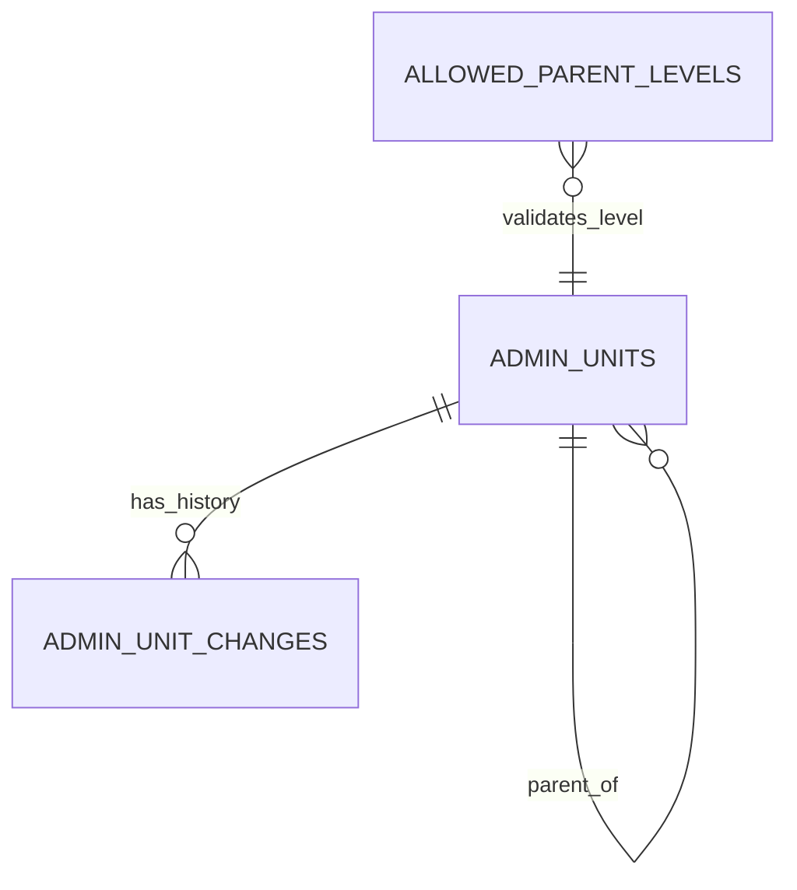

# Uganda Administrative Geography Reference Model

**Status:** implemented as a synthetic reference model; SQL execution not yet verified.  
**Engine:** PostgreSQL 15+. **Classification:** public reference metadata with source/steward review controls.  
**Scope:** administrative hierarchy and effective-dated reference data for use by local-government, service-request, asset, education, water, and public-service examples.

This package is a reusable reference-data model, not an authoritative list of Ugandan administrative units. It deliberately ships only clearly synthetic fixtures. Do not infer real district, city, county, sub-county, parish, ward, village or cell codes from these examples.

## Model

`admin_units` stores a stable internal code, label, level, parent, validity interval, source reference and verification state. `allowed_parent_levels` records the permitted hierarchy edges instead of assuming every locality follows one rigid chain. `admin_unit_changes` stores reasons and source provenance for steward-recorded changes. The trigger blocks invalid parent-level combinations and current duplicate codes; the retirement routine requires a reason/source/actor and prevents retiring a parent while it still has current children.



Supported levels are district, city, county, municipality, town council, sub-county, division, parish, ward, village and cell. These are candidate reference levels, not a claim that every type is present in every district or that every edge is valid under current law. Verify administrative arrangements, naming, effective dates and source identifiers with the responsible authority before use.

## Setup

Use a disposable PostgreSQL 15+ database and a role authorised to create schemas and (for `06_security.sql`) database roles.

```bash
psql "$DATABASE_URL" -v ON_ERROR_STOP=1 -f 01_schema.sql
psql "$DATABASE_URL" -v ON_ERROR_STOP=1 -f 02_seed.sql
psql "$DATABASE_URL" -v ON_ERROR_STOP=1 -f 03_views.sql
psql "$DATABASE_URL" -v ON_ERROR_STOP=1 -f 04_procedures.sql
psql "$DATABASE_URL" -v ON_ERROR_STOP=1 -f 06_security.sql
psql "$DATABASE_URL" -v ON_ERROR_STOP=1 -f 08_tests.sql
```

The versioned migration uses psql `\\ir` includes and must be run with psql from the package's migration directory. The numbered files are kept visible for learning and review. Do not run the role-creation script as an application runtime role.

## Example use

- Join service requests to an approved locality code without copying the full administrative hierarchy into every operational table.
- Report service counts at approved geographic levels and periods.
- Review unverified/newly changed reference entries.
- Trace the ancestry of a synthetic locality using `fn_get_ancestors`.
- Retire a leaf reference record with reason, source and actor metadata.

## Security, provenance and lifecycle

- Synthetic codes are internal demo keys; never treat them as official codes.
- `is_verified` must only be set after an authorised steward confirms the source.
- Keep source URL/document reference, retrieval date, steward, effective date and evidence in an approved change-control process.
- Do not store household-level or precise sensitive location data in this reference package.
- Reader and steward roles are NOLOGIN role groups; provision real users through approved identity management and grant only required memberships.
- This is not a legal register and does not establish data-sharing authority between agencies.

## Validation status and limitations

Assertions in `08_tests.sql` cover invalid roots, invalid parent edges, ancestor traversal and parent retirement. These tests have not yet been executed in a PostgreSQL runtime in this session. Review the migration and grants in a disposable database before adoption. The tiny synthetic fixture is not a performance benchmark. Independent review is required before operational use.
