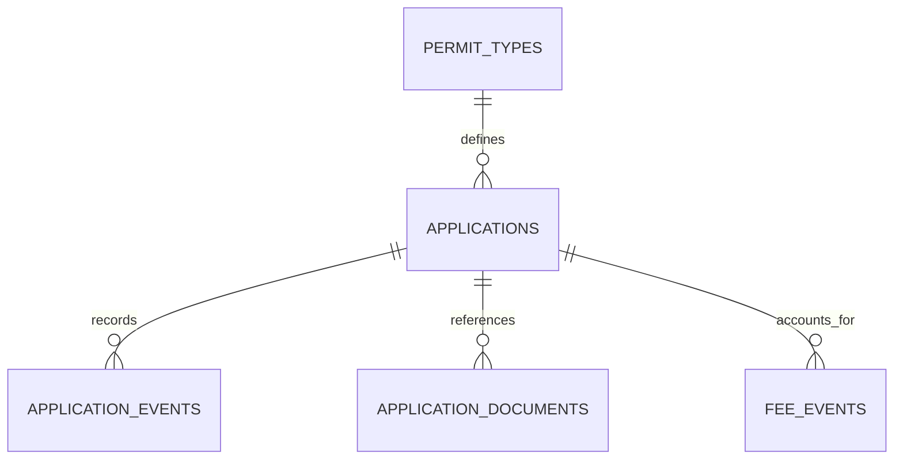

# Uganda Permit and Licence Case Workflow

**Status:** implemented as a synthetic educational package; SQL execution not yet verified.  
**Engine:** PostgreSQL 15+. **Data classification:** applicant references and case metadata are restricted.  
**Purpose:** demonstrate auditable permit/licence intake, review, document metadata, human decisions and fee-event reporting.

## Scope and boundaries

This is a generic workflow pattern for local-government or other authorised issuing offices. It is not an official government service, legal interpretation, fee schedule, permit registry, or integration with any agency. Validate the actual permit types, statutory steps, fees, appeals, retention and delegated authorities with the responsible office before adaptation.

Applicant identifiers are opaque references only. Do not store names, national identification numbers, phone numbers, residential addresses, or uploaded document contents in these tables. Document bytes belong in a separately authorised object store with its own encryption, access policy, malware scanning, retention and access logging.

## Model



- `permit_types`: illustrative permit definitions and issuing office code.
- `applications`: opaque applicant reference, locality reference, state and key timestamps.
- `application_events`: append-oriented transition history with actor, reason and evidence reference.
- `application_documents`: document metadata and SHA-256 digest; no binary content.
- `fee_events`: fee/payment/waiver/reversal facts, not a bank or payment processor.

The transition routine locks the application row, validates permitted state transitions and requires an evidence reference for approval/rejection. The final decision must be made by an authorised human. The schema does not establish legal eligibility and must not automatically deny a permit.

## Setup

Use a disposable PostgreSQL 15+ database and a controlled role allowed to create schemas and role groups.

```bash
psql "$DATABASE_URL" -v ON_ERROR_STOP=1 -f 01_schema.sql
psql "$DATABASE_URL" -v ON_ERROR_STOP=1 -f 02_seed.sql
psql "$DATABASE_URL" -v ON_ERROR_STOP=1 -f 03_views.sql
psql "$DATABASE_URL" -v ON_ERROR_STOP=1 -f 04_procedures.sql
psql "$DATABASE_URL" -v ON_ERROR_STOP=1 -f 06_security.sql
psql "$DATABASE_URL" -v ON_ERROR_STOP=1 -f 08_tests.sql
```

The versioned migration uses psql `\\ir` includes. The numbered SQL files remain available for stepwise learning. Do not run role-creation scripts as an application runtime identity.

## Security and governance

- Replace demo office and locality codes with approved reference data and provenance.
- Use parameterised queries; do not concatenate user input into SQL.
- Store only opaque applicant references and restrict case access to assigned staff.
- Store document content outside the database in an approved encrypted document store.
- Preserve decision actor, reason, timestamp and evidence reference.
- Reconcile fee events against authorised finance records; this package is not a ledger of record.
- Define retention, correction, appeal, disclosure and deletion rules before real use.
- Production roles should be provisioned through identity management and reviewed for separation of duties.
- No live applicant, citizen or payment data is included.

## Validation status

`08_tests.sql` asserts invalid state transitions, decision evidence requirements, document digest validation and event history. These assertions have **not** been executed in a PostgreSQL runtime in this session. Run them on a disposable PostgreSQL 15+ database and review the grants before adopting the example. Index plans on the tiny seed data are not production benchmarks.
