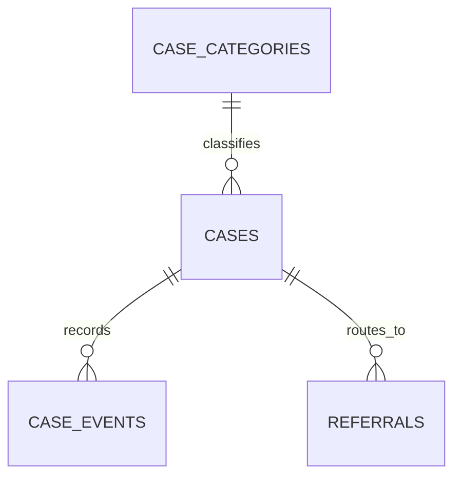

# Uganda Public Complaints and Referral Workflow

**Status:** synthetic educational implementation; SQL execution not yet verified.  
**Engine:** PostgreSQL 15+. **Scope:** confidential case metadata, triage, inter-office referral and SLA reporting.

## Purpose and boundaries

This package is distinct from a municipal service-request tracker: it demonstrates confidential complaints and referral coordination, not public reporting of potholes or waste pickups. It is not an official complaints channel, ombudsman system, police case-management system or legal process. Validate the receiving offices, response SLAs, lawful authority and escalation path with the actual case owner.

The schema stores opaque references and workflow metadata only. Do not store complaint narratives, names, national IDs, phone numbers, home addresses, witness identities, health details or evidence contents in these tables. Evidence references point to a separately secured store.

## Model



Case transitions require an actor and reason; resolution/closure/withdrawal require an evidence reference. Referrals can be created only after triage or assignment, and a referral moves the parent case to the referred state. SLA views support aggregate operational monitoring.

## Setup

Run on a disposable PostgreSQL 15+ database using a controlled schema owner.

```bash
psql "$DATABASE_URL" -v ON_ERROR_STOP=1 -f 01_schema.sql
psql "$DATABASE_URL" -v ON_ERROR_STOP=1 -f 02_seed.sql
psql "$DATABASE_URL" -v ON_ERROR_STOP=1 -f 03_views.sql
psql "$DATABASE_URL" -v ON_ERROR_STOP=1 -f 04_procedures.sql
psql "$DATABASE_URL" -v ON_ERROR_STOP=1 -f 06_security.sql
psql "$DATABASE_URL" -v ON_ERROR_STOP=1 -f 08_tests.sql
```

The versioned migration uses psql `\\ir` includes. All seed records are synthetic.

## Safeguards

- Restrict case-level access to staff with a defined role and case assignment.
- Keep evidence in a separate encrypted store with access logging and retention controls.
- Publish only aggregated SLA metrics after privacy and small-cell review.
- Preserve actor, reason, timestamp and evidence references for material state changes.
- Define safe intake, safeguarding, emergency escalation and complainant protection procedures outside SQL.
- Do not infer misconduct from complaint counts or overdue referrals; review context and data quality.
- Provide correction, appeal, withdrawal and lawful disclosure policies before real use.

## Validation status

`08_tests.sql` asserts evidence-gated closure, triage-before-referral and parent-case transition behavior. These assertions have **not** been executed in a PostgreSQL runtime in this session. Operational adoption requires qualified privacy, safeguarding, legal and workflow review.
