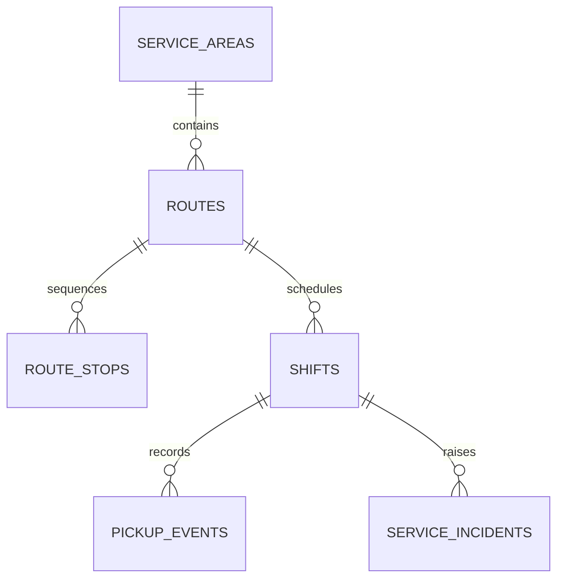

# Uganda Local Government Waste Collection Reliability

**Status:** synthetic municipal service example; PostgreSQL execution unverified.  
**Scope:** service areas, route stops, shifts, pickup evidence, missed-service incidents and completion reporting.

## Intended users and ownership

Municipal operations planners, route clerks, waste-service contractors and oversight analysts. A deploying authority must define route ownership, service frequency, accepted evidence, safety escalation, and contractor reporting obligations. No household names, exact private premises or identifiable resident complaint text are stored.

## Model

## Setup

Run numbered files on PostgreSQL 15+. The migration uses psql `\\ir` includes. All locality, route, vehicle, crew and service-point values are synthetic.

## Safeguards

- Exception records require reasons and evidence; missed service is not silently treated as collected.
- Report aggregate completion and incident patterns; do not publish household-level pickup histories.
- Include manual/paper evidence reconciliation for intermittent connectivity.
- Record safety-related non-collection as an exception, not a failure to follow an unsafe instruction.
- Validate contractor SLAs, route calendars, volume units, access policy and backup/restore procedures locally.

## Validation

The assertions cover route membership and missing exception reasons. PostgreSQL tests have **not** been executed here. Validate duplicate stop submissions, shift corrections, concurrent uploads, locality scoping and restoration before operational use.
