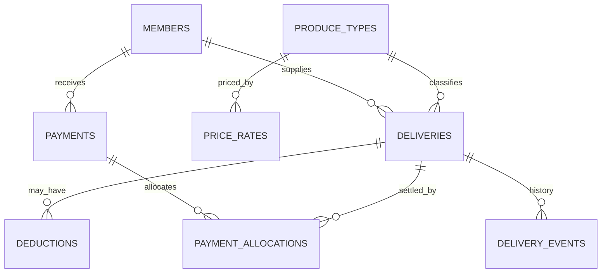

# Uganda Cooperative Produce Payment Ledger

**Status:** synthetic educational implementation; SQL execution not yet verified.  
**Engine:** PostgreSQL 15+. **Scope:** produce delivery records, effective-dated price rates, approved deductions and payment allocation.

## Purpose

Demonstrate how a cooperative can connect accepted produce weights to a sourced price rate, preserve deduction reasons and allocate recorded payments to delivery liabilities. This is not an official cooperative registry, mobile-money integration, bank ledger, tax engine or production accounting system.

## Model



- Deliveries preserve gross and accepted weight, grade, source ticket and scale reference.
- Price rates have effective dates, currency, source and approver. Rate-overlap prevention and governance still need deployment-specific controls.
- Only approved deductions reduce the illustrative net valuation.
- Payments use an idempotency key and opaque external payment reference; credentials and account/card data must never be stored here.
- The allocation function locks payment and delivery rows and prevents allocating more than the payment remainder or the current delivery net value.
- Corrections should be explicit reversal/correction events; do not silently rewrite posted delivery/payment facts.

## Setup

Run on a disposable PostgreSQL 15+ database with a controlled schema owner.

```bash
psql "$DATABASE_URL" -v ON_ERROR_STOP=1 -f 01_schema.sql
psql "$DATABASE_URL" -v ON_ERROR_STOP=1 -f 02_seed.sql
psql "$DATABASE_URL" -v ON_ERROR_STOP=1 -f 03_views.sql
psql "$DATABASE_URL" -v ON_ERROR_STOP=1 -f 04_procedures.sql
psql "$DATABASE_URL" -v ON_ERROR_STOP=1 -f 06_security.sql
psql "$DATABASE_URL" -v ON_ERROR_STOP=1 -f 08_tests.sql
```

The versioned migration uses psql `\\ir` includes. Seed records are synthetic and rerunnable.

## Safeguards

- Use opaque member references; do not store national IDs, contact details or home addresses.
- Require independently approved rate cards with provenance and effective dates.
- Record calibrated scale references, ticket identifiers and transparent grade/weight corrections.
- Require a reason, source and separate approval for deductions.
- Reconcile payment references against the authorised provider/bank record outside this demo.
- Enforce member ownership and payment allocation limits; review allocation permissions and concurrency.
- Publish clear member statements and provide a dispute/correction process.
- Keep actual financial and beneficiary data out of training fixtures.

## Validation status

`08_tests.sql` includes assertions for invalid weights, allocation ceilings and idempotency. These tests have **not** been executed in a PostgreSQL runtime in this session. The valuation is a teaching model, not a financial control certification; production use needs independent accounting, concurrency, access-control, audit and recovery review.
