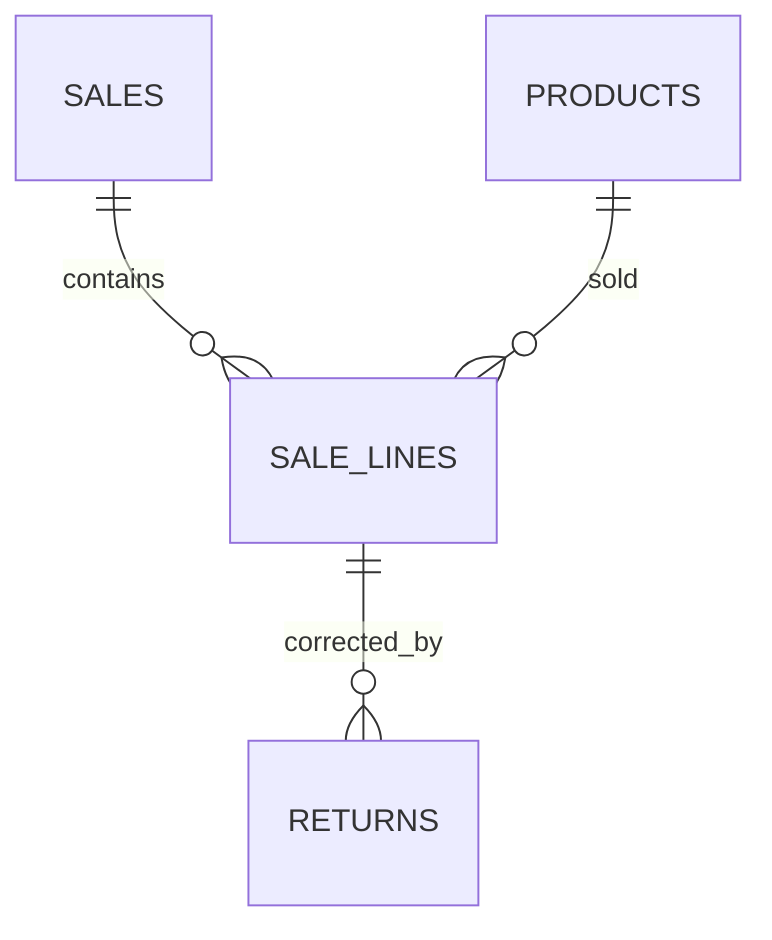

# Uganda Cooperative and SME Sales Analytics

**Status:** synthetic analytics example; PostgreSQL execution unverified.  
**Scope:** sale facts, product categories, return ledger, monthly net sales, gross margin and tokenised repeat-sale summary.

## Intended users and boundaries

Cooperative managers, SME owners, sales clerks and aggregate analysts. This package complements the retail POS and cooperative produce ledger; it does not replace source-of-truth sales receipts, tax calculations, inventory accounting or payment systems.

## Model

## Setup

Run numbered files on PostgreSQL 15+. The migration uses psql `\\ir` includes. Fixtures use synthetic business, customer and receipt references.

## Analytics definitions

- Net quantity equals sold quantity less recorded returned quantity.
- Net sales equal line gross sales less recorded refunds.
- Gross margin uses net sales less net quantity times unit cost; it excludes overhead, tax treatment, shrinkage and payment fees.
- Monthly summaries are grouped by business, month, category and currency. Never aggregate multiple currencies without a conversion policy.
- Customer-token repeat analysis is restricted and must not be used to expose individual purchasing histories.

## Safeguards and validation

Returns require an existing completed sale, lock the sale/line, cannot exceed sold quantity or original line value, and use unique source/idempotency references. No names or direct customer identifiers are stored. SQL assertions have **not** been run in this session. Validate return reversals, tax/discount allocation, concurrent return requests, data retention and accounting reconciliation before live use.
