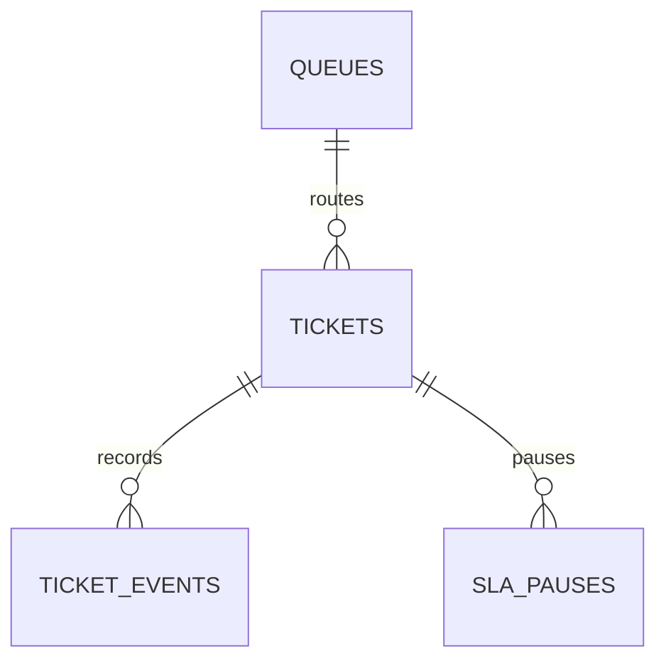

# Uganda SME Customer Support and SLA Tracker

**Status:** synthetic workflow; PostgreSQL execution unverified.  
**Scope:** support tickets, status history, first-response timing, SLA queue and aggregate performance.

## Intended users

Support agents, supervisors and aggregate service-quality analysts. A real implementation must define response calendars, priority rules, escalation policy, data owner and customer notice. SLA calculations in this teaching package use elapsed wall-clock minutes; business-hours calendars are referenced but not evaluated by the SQL.

## Model

## Setup

Run numbered files on PostgreSQL 15+. The migration uses psql `\\ir` includes. Synthetic customer tokens and redacted ticket text only.

## Safeguards

- Never store passwords, authentication tokens, payment-card data or secrets in ticket text.
- Redact attachments and internal notes; enforce tenant/customer scope and least privilege.
- SLA pauses require an approved reason and evidence; audit them separately from elapsed wall-clock time.
- Preserve ticket history; use controlled correction events rather than silent overwrites.
- Do not infer staff misconduct from SLA metrics without workload, calendar and case-complexity context.

## Validation

Included assertions cover one-time first-response recording and resolution. PostgreSQL tests have **not** been run in this session. Validate business-calendar semantics, pause accounting, concurrent transitions, row scoping and backup recovery before operational use.
