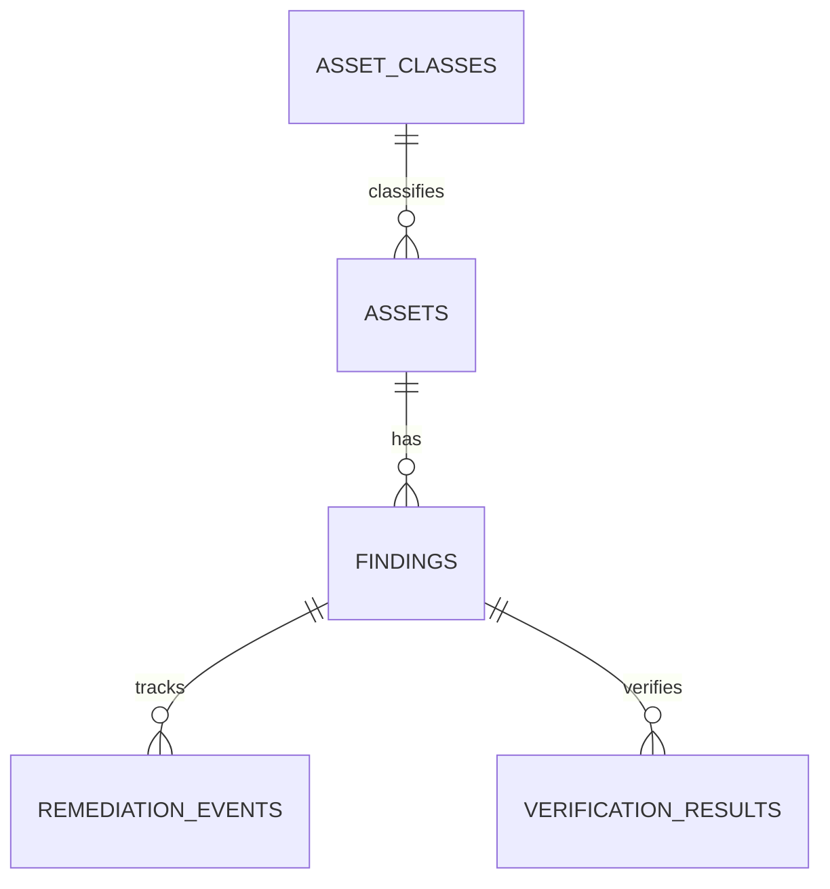

# Uganda Defensive Cybersecurity Asset and Remediation Register

**Status:** synthetic defensive governance example; PostgreSQL execution unverified.  
**Scope:** authorised asset inventory, findings metadata, remediation deadlines and independent verification.

## Intended users and boundaries

Security asset owners, remediation coordinators and independent verifiers. This is a governance register, not a scanner, exploit tool or vulnerability-disclosure portal. It intentionally excludes credentials, exploit steps, precise public IPs, secrets and raw scan payloads.

## Model

## Setup

Run numbered files on PostgreSQL 15+. The migration uses psql `\\ir` includes. All assets, owners and evidence references are synthetic.

## Safeguards

- Record only assets that the organisation is authorised to inventory and assess.
- Keep technical detail and raw scan output in access-controlled security tooling.
- Require a verifier different from the remediation owner before marking a fix verified.
- Risk acceptance requires a recorded reference and should have an expiry/review process.
- Treat severity and overdue status as prioritisation aids, not a substitute for threat modelling.
- Restrict asset ownership and environment details; audit exports and retain evidence safely.

## Validation

Included assertions cover independent verification. PostgreSQL tests have **not** been run here. Validate owner mapping, re-open flows, finding correction, retention and backup recovery before operational use.
