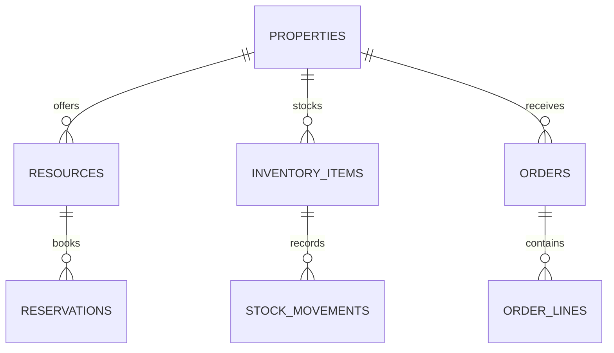

# Uganda Hospitality Booking and Stock Integration

**Status:** synthetic hospitality workflow; PostgreSQL execution unverified.  
**Scope:** property resources, overlapping booking protection, inventory movement and stock consumption.

## Intended users and boundaries

Guesthouse/hotel booking clerks, restaurant stock clerks and operations managers. This is not a booking marketplace, payment gateway, accounting system or tax application. No payment card details, guest identity documents or raw contact information are stored.

## Model

## Setup

Run numbered files on PostgreSQL 15+. The migration uses psql `\\ir` includes. All guest, property, order and stock references are synthetic.

## Safeguards

- Booking locks the resource row before checking overlaps, serialising concurrent requests for the same room/table.
- Capacity, resource status and interval validity are checked before booking.
- Stock consumption locks the item row and prevents a negative balance.
- Use opaque customer tokens, restrict reservation visibility and define retention for guest records.
- Do not store raw card numbers, CVV, authentication secrets or identity documents.
- Payment, tax, accounting, overbooking policy, no-show fees and booking cancellation terms require separate approved systems and review.

## Validation

Assertions cover overlapping bookings and stock underflow. SQL tests have **not** been run in this session. Validate concurrent reservations, daylight-saving/time-zone boundaries, cancellation/restoration, partial stock delivery and recovery before operational use.
