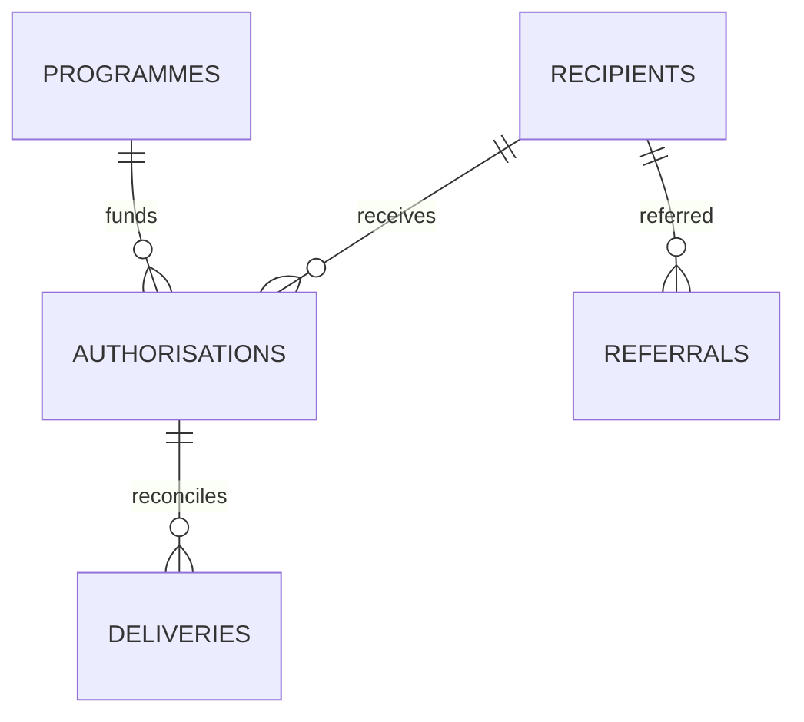

# Uganda Humanitarian Assistance Delivery Reconciliation

**Status:** synthetic high-sensitivity workflow; PostgreSQL execution unverified.  
**Scope:** programme authorisations, pseudonymous recipient tokens, delivery attempts, referrals and reconciliation.

## Intended users and data ownership

Authorised aid programme managers, delivery clerks and trained case workers. The implementing organisation must identify the data controller, legal/consent authority, safeguarding owner, programme eligibility policy and referral partner. This model does not decide eligibility and is not an official beneficiary registry.

## Model

## Setup

Run numbered files on a disposable PostgreSQL 15+ database. The migration uses psql `\\ir` includes. All recipient tokens, locations, sources and evidence references are synthetic.

## Safeguards

- Never store names, exact household coordinates, protection narratives or identity documents here.
- Use case-level access, minimal necessary fields, encryption, retention rules and approved data-sharing authority.
- Delivery requires a human-approved authorisation, a live recipient token, evidence and an idempotency key.
- Record failed/returned deliveries with reason; do not infer misconduct from a discrepancy.
- Do not publish identifiable assistance records or small-cell recipient patterns.
- Confirm consent/authority and safe referral procedures before recording referrals.

## Validation

Assertions cover delivery quantity ceilings and idempotency. SQL was **not executed in this session**. Before any real deployment, complete safeguarding, privacy, role-scope, concurrent-delivery and backup/restore review.
