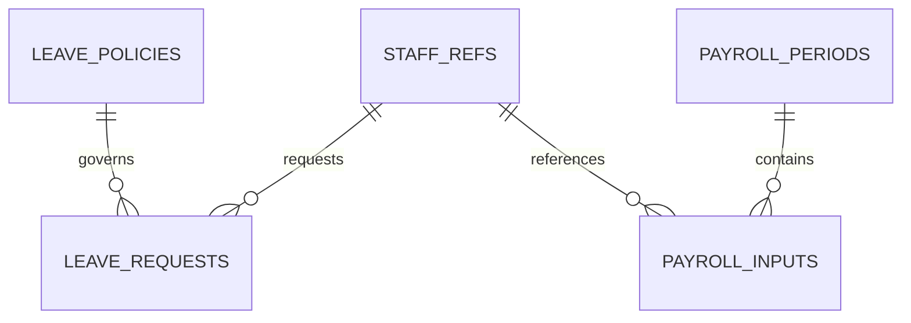

# Uganda HR Leave and Payroll Input Workflow

**Status:** synthetic HR/payroll input-control example; PostgreSQL execution unverified.  
**Scope:** staff references, leave requests and approvals, payroll-period controls, source-evidenced inputs and controlled export readiness.

## Important boundary

This package is not a payroll calculator, tax filing system, salary payment system, bank integration or general ledger. It deliberately avoids salary amounts and bank details; input rows are references/quantities supplied by authorised source systems. A real deployment must validate Ugandan labour, tax, social-security, privacy and records obligations with qualified professionals.

## Model

## Setup

Run numbered files on PostgreSQL 15+. The migration uses psql `\\ir` includes. All staff and evidence identifiers are synthetic.

## Safeguards

- Keep staff identity mapping in a separately protected HR system and restrict row access by employing unit.
- Require independent, evidence-backed leave decisions and payroll period approval.
- Resolve leave requests that overlap a payroll period before export approval.
- Encrypt and tightly scope any export; record export reference and retention rules.
- Do not silently overwrite approved inputs; record source references and correction references.
- Payroll calculations, tax treatment, deductions, payments and statutory filings remain outside this package.

## Validation

The included assertions cover evidence-backed leave review and payroll period approval. SQL was **not executed in this session**. Test role scope, period locking, approved-input mutation prevention, export signing, and recovery before operational use.
