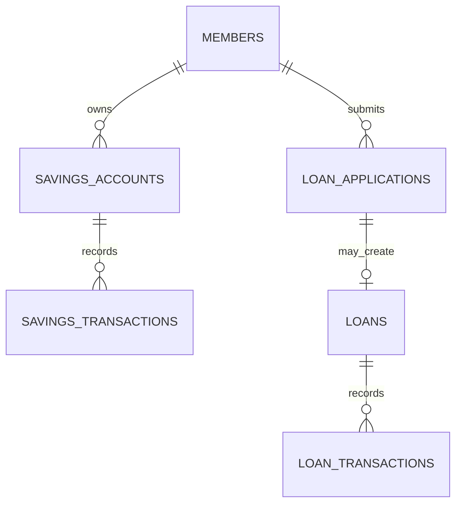

# Uganda SACCO Savings and Loan Ledger Prototype

**Status:** synthetic high-risk financial teaching prototype; PostgreSQL execution unverified.  
**Scope:** pseudonymous member references, savings transaction ledger, human-reviewed loan applications and principal-only loan transactions.

## Important boundaries

This is not a production SACCO core-banking platform, credit-scoring system, statutory ledger, payment rail or regulatory compliance implementation. It intentionally excludes names, national IDs, contact details, bank credentials, automated eligibility decisions, interest/penalty calculations and real funds.

## Model

## Setup

Run numbered files on a disposable PostgreSQL 15+ database. The migration uses psql `\\ir` includes. All member, transaction and evidence references are synthetic.

## Controls and limitations

- Loan approval is an explicit human decision with reason/evidence and a principal ceiling no greater than the request.
- Loan transactions lock the loan row and use idempotency/external references; repayment cannot exceed principal balance.
- Savings and loan balances are derived from transaction rows rather than overwritten balance fields.
- Member-level access, independent maker-checker roles, transaction reversals, accounting reconciliation, interest, fees, arrears, collateral and statutory reporting are not comprehensively implemented.
- No automated credit decision, risk score or denial rule is included.
- Real use requires qualified accounting, legal, security, consumer-protection and regulatory review.

## Validation

Assertions cover approval ceiling, disbursement, repayment overrun and settlement. SQL tests have **not** been executed here. Do not connect real member records or money flows until a qualified independent review, transaction/concurrency tests and recovery exercises pass.
