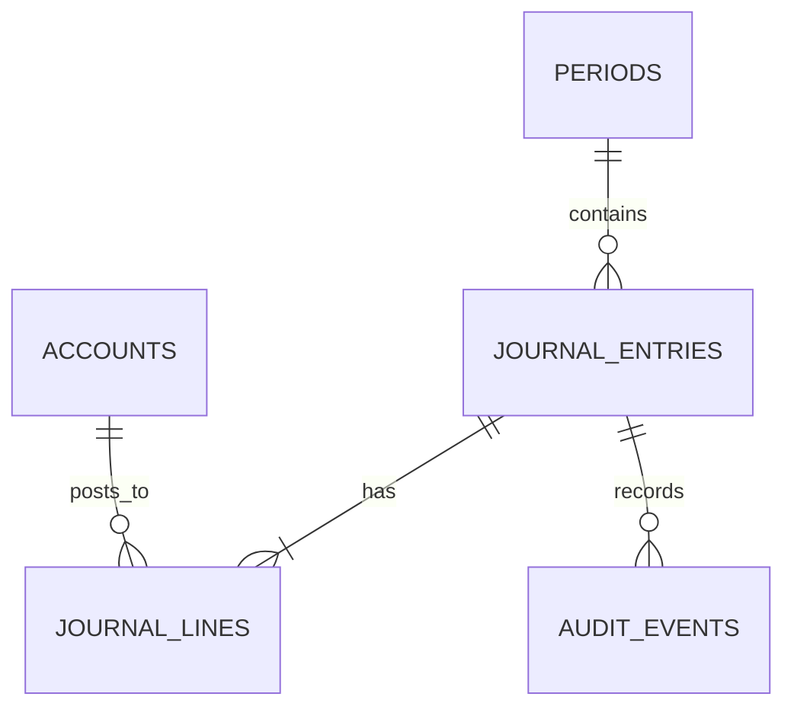

# Uganda SME Double-Entry Bookkeeping Ledger

**Status:** synthetic educational ledger; PostgreSQL execution unverified.  
**Scope:** chart of accounts, accounting periods, draft journals, balanced posting and trial balance.

## Intended users and boundaries

SME bookkeepers, independent journal posters and aggregate finance reviewers. This is a teaching model, not certified accounting software, tax advice, a statutory filing engine, bank integration or a complete receivables/payables application.

## Model

## Setup

Run numbered files in order on a disposable PostgreSQL 15+ database. The versioned migration uses psql `\\ir` includes. Seed records are synthetic and the sample journal balances.

## Controls

- Every posted journal has at least two lines and equal positive debit/credit totals.
- Posting requires an open period, in-period transaction date, actor and evidence.
- Posted/reversed journal lines are immutable; corrections should be handled through evidenced reversal entries.
- Journal preparers and posters are separate role groups; real deployments must map them to different authenticated people.
- Period close is blocked while draft journals remain.
- Add tax, currency conversion, bank reconciliation, receivables/payables, statutory reporting and retention only under qualified accounting review.

## Validation

Assertions cover balanced posting, immutability and period close. PostgreSQL tests have **not** been executed in this session. Test transaction isolation, concurrent posting, period locking, reversal workflows and backup recovery before operational use.
