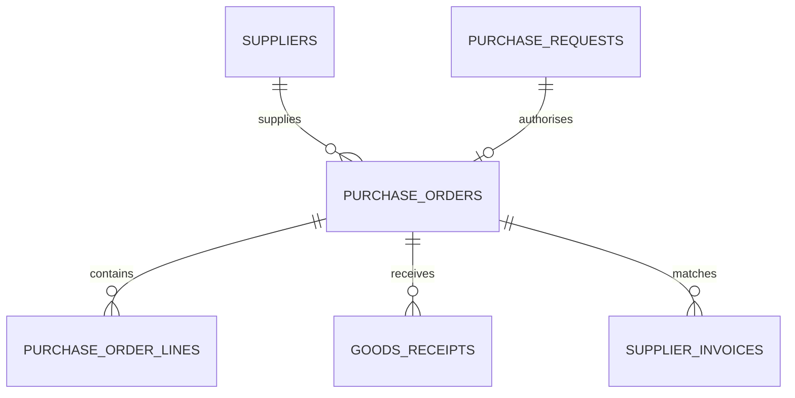

# Uganda SME Supplier and Purchase-Order Workflow

**Status:** synthetic educational workflow; PostgreSQL execution unverified.  
**Scope:** purchase requests, supplier references, purchase orders, receipts and invoice matching.

## Intended users and boundaries

SME owners, requesters, purchasing clerks, goods-receiving staff and independent invoice reviewers. This example is not a full accounting package, payment gateway or bank integration. It does not initiate payments or replace tax/accounting advice.

## Model

## Setup

Run numbered files on a disposable PostgreSQL 15+ database. The migration uses psql `\\ir` includes. All supplier and evidence references are synthetic.

## Controls

- Use a request/approval split and independent invoice review.
- Compare invoice value with order value and accepted goods value before approval.
- Keep receipt and invoice evidence references; do not store bank credentials or raw payment-card data.
- Handle returns, rejected quantities, credit notes and reversals as auditable events rather than deleting history.
- Enforce supplier due diligence, user permissions and accounting-period controls outside this teaching schema.
- Payment execution and general-ledger posting are explicitly out of scope.

## Validation

Assertions are included for the missing-receipt invoice case, but PostgreSQL tests have **not** been run here. Validate partial receipts, tax/rounding rules, credit notes, concurrency, role scoping and recovery before live use.
